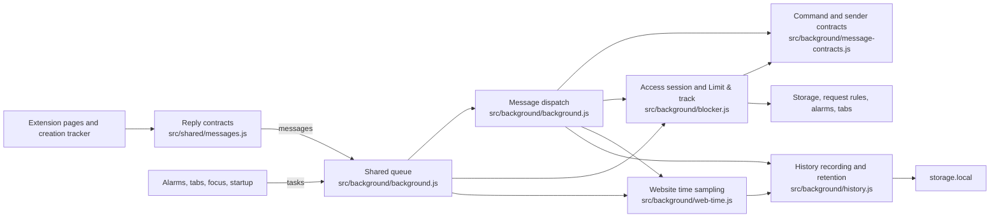
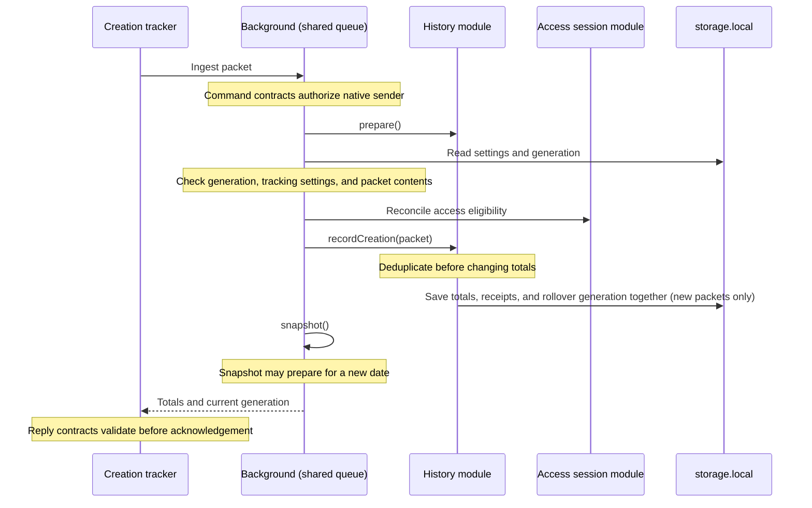

# CreateRatio browser extension

A dependency-free Manifest V3 extension for intentional access to X and LinkedIn
and local creating-versus-consuming tracking.

## Layout and installation

- `src/manifest.json`: browser permissions and packaged runtime entry points.
- `src/background/`: background worker, access blocking, history, and website time.
- `src/content/`: creation tracker, access guard, route hook, DOM helpers, and optional scroll friction.
- `src/pages/`: popup, Settings, dashboard, and blocked-page HTML, scripts, and page-specific styles.
- `src/shared/`: shared UI styles, refill animation, and feedback.
- `src/icons/`: extension icons.
- `src/tests/`: cross-feature tracers, seeded lifecycle properties, build checks,
  and shared test harnesses.
- `browser-tests/`: real Chromium journeys against the generated Chrome bundle.
- `core/`: browser-independent scoring, time, history, and data helpers with tests.
- `sites/`: vetted website tracking adapters, catalog, and colocated tests.
- `build.js` and `package.json`: build and test commands.

The build copies the explicitly listed runtime assets to flat packaged paths;
icons retain their `icons/` directory. HTML links, script imports, and manifest
paths refer to the packaged layout, not the source folders. Focused `.test.js`
files live beside the modules or pages they test; cross-feature tests and shared
harnesses stay in `src/tests/`. Test commands discover tests recursively, and the
explicit build asset list excludes tests and harnesses.

[Install the published Chrome extension from the Chrome Web Store](https://chromewebstore.google.com/detail/kopbjmlmjpnkekffalpbjfhmbhgbgamk).
Save X and LinkedIn drafts before installing; existing tabs redirect to the
access gate.
[Install the published Firefox add-on](https://addons.mozilla.org/en-US/firefox/addon/createratio/).
For development builds or Edge, follow the
[build and installation instructions](../README.md#build-and-install).
Edge does not have a published store release.
The standalone website lives separately in `../site/`.

## Runtime structure

Pure functions in `core/` and `sites/` express scoring, classification, and
preference decisions. Stateful modules keep their implementation private behind
small interfaces; browser effects remain explicit. The background's single
serialization queue protects shared read-modify-write operations.



The access module owns Limit & track changes and recovery. The history module
owns date buckets, accumulation, receipt rollover, retention, and clearing;
creation tracking and website time remain distinct measurements.

Domain policies in `core/` own duration, intention, calendar-date, and delivery
limits. Forms preview these rules; command receivers enforce them. Command
contracts own native sender identity, page/frame authority, and packet shape.
The reply adapter refuses malformed successes before queues acknowledge packets
or access pages navigate. Access eligibility and browser permissions remain
execution-time checks, not cached validation results.

Pages poll for countdown and website-time updates. Storage notifications refresh
access phase changes, preferences, creation activity, and history resets; countdown-only
access writes and website-time accrual do not trigger cross-page refreshes.

Owning data modules normalize restored records separately from new commands.
History reads normalize copies without rewriting saved records; numeric strings
receive no score credit. Invalid sessions and impossible waits grant no access.
Ambiguous receipt journals retire their generation without deleting totals.
Malformed non-array tracking selections recover to all sites Off. Missing
preferences retain normal defaults; repairing a selection requires an explicit
choice and never revives a discarded session.
Creation tracking's exact HTTPS hosts, access gating's HTTP/S aliases and
subdomains, and website time's general non-private domains remain separate.

### Creation tracking delivery order

Sender authorization, packet validation, and access eligibility stay in the
background. Preparation must precede generation validation and must not repeat
between that check and recording: midnight preparation can retire legacy receipts.



Closures, adapters, queues, and timers do not survive worker replacement.
Preferences, access budgets, receipts, and histories are reconstructed from
`storage.local`; the `storage.session` initialization marker distinguishes worker
replacement from a browser restart. Website-time sampling starts fresh.

## Using the extension

- **Popup:** today's score, active time, and request/end-access controls.
- **Settings:** one Default session-time row and one row per vetted site with a
  **Limit & track** switch. Times show **From Default** or **Custom**; **Use Default**
  removes an override. Off disables time editing/reset without losing saved times.
  Slow scrolling, above-goal access, Website time, intention saving, exports, and
  history clearing remain separate. Preferences save automatically.
- **Dashboard:** per-site totals, charts, all-website time, intention history,
  shareable daily/seven-day PNG cards, detailed reports, and CSV exports.

### Browser agents and accessibility

Browser agents use the same UI as people; there is no public agent API or
external messaging bridge. Tools must support installed extension pages.
Open CreateRatio from the extensions menu; use **Open dashboard** or **Settings**
for full pages rather than hard-coding an installation-specific extension ID.

Site-access buttons have site-specific accessible names and describe the current
state. Settings expose native switches and labeled session-time fields;
dashboard views expose pressed states and hide inactive panels. The access gate
exposes its form, intention requirements, waiting/active regions, and disabled
confirmation state. Use roles and names, not row positions. Check save status or
errors after actions. All intention, wait, and explicit confirmation rules remain.

The public [AI and browser-agent guide](https://createratio.com/llms.txt) covers
these workflows and consent boundaries. Reading this guide does not grant an
agent permission to change settings, export private data, or bypass access gates.

### Site access

X, Twitter aliases, and LinkedIn, including subdomains, are blocked on HTTP and
HTTPS. Blocking covers the whole site, including posting and messages.

1. Visit a blocked site or choose **Request access**.
2. Write an intention of 20–280 characters and start the **60-second wait**.
3. Explicitly confirm access when the wait finishes. Waiting alone never unlocks.
4. Use the shared per-site active-time budget: **five minutes** by default,
   configurable from 1–240 minutes in Settings. Only the active tab in a focused
   browser window uses the budget; other sites remain blocked.

Reloading does not reset the wait. Cancelling does; unconfirmed requests expire
ten minutes after the wait finishes. The popup can end access early. Remaining
budgets survive restarts and refill to the configured duration at local midnight,
without accumulating. Never-opened sites stay blocked; manually ending a session
cancels its daily refill.

**Save drafts before expiry:** open tabs redirect to the local blocked page.

Optional **Allow sites while above the daily goal** skips gates and timers only
while today's aggregate score is strictly above the current daily target
(default 1.0). Existing timed budgets pause. At or below the target, on a new day,
or when disabled, normal gates return unless a timed budget still has time.

### Tracking choices

X and LinkedIn start with **Limit & track** On. Off removes the site's gate,
wait, timer, and new creation-score measurements together. Saved duration and
history remain. Off discards the current budget and waiting request, including
its midnight refill. Re-enabling requires a fresh intention and wait unless
optional above-goal access applies. Fresh trusted input is required to measure.

New vetted integrations start disabled; arbitrary domains or user scripts cannot
be added from the UI. Integrations without explicit gate support remain
tracking-only.

### Slow scrolling

**Settings → Slow scrolling** is on by default at **50% resistance**. Saved Off
choices are preserved. Its **Scroll resistance** slider ranges from **50% (Light)**
to **95% (Heavy)** in five-point steps. Higher resistance means less vertical page
movement for the same wheel or trackpad gesture, in either direction. The default
**50%** moves the page half as far; **75%** moves it a quarter as far; **95%** moves
it one twentieth as far. Every enabled strength adds resistance; the maximum still
allows movement. Turn the switch off for native scrolling; it remembers your
strength for next time. Saved positive strengths below 50% resolve to 50%. A saved
zero resolves to Off with 50% ready for re-enabling.

The percentage and distance preview update while dragging; the preference saves
when you release the slider or use its keyboard controls. It applies to open tabs
without a reload. Changes replace only a cached scroll multiplier, without a
timer, popup, or queued animation. It applies only to consuming pages on enabled
sites during timed or above-goal access, using the existing page classification
below. Turning a site's Limit & track off also removes its scroll friction.

Editors, messaging routes, nested scroll panels, horizontal gestures, and zoom
stay native. When the document cannot scroll, including when its overflow is
hidden or clipped, an inner container becomes the page surface only if it is the
sole scrollable ancestor under the pointer and fills at least half the viewport
height. Panels inside another scrollable container stay native regardless of
height; a lone smaller panel stays native too. An independently scrolling body
is included in that ancestry; body overflow propagated to the viewport is not
counted as a separate scroller. A body's hidden or clipped overflow only locks
the document when it propagates to the viewport; root overflow and CSS
containment can prevent that propagation. Keyboard scrolling, touch gestures, and scrollbar
dragging are unchanged. Line-based wheel input uses a 16-pixel
line; page-based input uses the height of the surface being scrolled. Physical
trackpad feel and native wheel settings vary by browser and operating system.
No scroll distances or additional activity data are saved.

The tracker owns the optional wheel listener and removes it when the page becomes
inactive, neutral, creating, disabled, or stopped. Scroll handling adds no timers,
observers or background messages. It retains at most one last-target DOM reference
for fractional movement. Handling another surface replaces that reference; an
actual speed change clears it, including switching Off or tracker deactivation.
A removed surface and its subtree can remain retained until one of those events.
Settings previews do not send messages. Committed adjustments keep at most one
in-flight save and one replaceable latest choice; they do not queue every
intermediate slider value.

## Measurement and score

Creation-score measurements require Limit & track On and timed or optional
above-goal access. Both the content tracker and background reject measurements
while blocked or Off. The budget counts all active-tab time, including creating,
consuming, and neutral pages—not only consuming time. Default changes affect
inherited times, while explicit site overrides remain unchanged. Duration changes
apply to new sessions and midnight refills, not the current budget.

Tracking runs on HTTPS X and LinkedIn hosts, with and without `www.`.
Old Twitter URLs must redirect to X first.

| Site | Consuming | Creating |
| --- | --- | --- |
| X | Home, Explore, Search, other profiles and status pages | Post/reply/quote editors and a focused home composer |
| LinkedIn | Feed and other personal/company/school profiles | Focused post, comment, or direct-message editors |

Known own profiles and unsupported routes are neutral. If the own-profile link
cannot be identified, profiles default to consuming. Editors take precedence;
a blank, unfocused composer does not turn the feed into creating time.
Writing direct messages counts as creating on messaging pages and in chat overlays.
Reading messages on messaging pages stays neutral; unfocused overlays leave the
underlying page's classification unchanged. Sending a direct message earns no
post or comment bonus. Message text is never read or saved.

Only visible, focused documents with trusted input in the last **30 seconds**
count. Time saves roughly every five seconds and splits at local midnight.
Sleep/timer gaps over 15 seconds are discarded, not backfilled. Navigating away
pauses tracking; returning to a cached page requires fresh input and never counts
time spent elsewhere. Closing a tab or browser can lose the last unsaved partial tick.

If saving repeatedly fails, each document keeps at most 64 pending packets, with
at most 64 time segments and 64 actions per packet. At that limit, new measurements
pause instead of growing memory or discarding queued actions. Delivery keeps
retrying; after the backlog drains, fresh trusted input resumes measurement.
Activity during the pause is not backfilled. Pending measurements also expire
when the shared 512-receipt delivery window rolls over. Ambiguous old retries
are discarded instead of counting twice; saved totals remain. Fresh input is
required after a delivery-window reset.

Actions count trusted submit interactions, not proof of server acceptance.
Supported shortcuts are Ctrl/Cmd+Enter in X editors and plain Enter in LinkedIn
comment editors. Keyboard submissions and resulting clicks are deduplicated.
Newlines, composition, repeated keys, and unsupported shortcuts do not count.
Changed markup, translations, or failed submissions can affect accuracy.

```text
score = (createSec + 120 * (posts + replies + comments)) / max(consumeSec, 1)
```

The daily score aggregates recorded sites before calculating. Posts, replies,
and comments receive two minutes of credit. Quotes also count as posts, without
a second bonus. Likes, bookmarks, and reposts receive no score credit. With no
consuming time, the denominator is one second and the score can be large.
The badge is green at 1 or above, yellow at 0.5–1, and red below 0.5.
Charts show active time without action credits.

See the [core contract](core/README.md) and [integration interface](sites/README.md)
for contributor-facing details.

## Optional all-website time

Enable **Website time** in Settings and approve optional `tabs` and `idle`
permissions. Declining leaves it off; turning it off removes those permissions
and preserves recorded totals.

Only the active HTTP/HTTPS tab in a focused normal window counts. Tracking pauses
when the computer is idle for 30 seconds or locked. Private tabs, background tabs,
browser pages, and extension pages are excluded. Timing is approximate;
sleep gaps, backward clock changes, and restarts are not backfilled.

The dashboard offers today, seven-day, and 30-day domain totals. `www.` is grouped
with the bare hostname; other subdomains stay separate. Tracking starts at opt-in
and does not import browser history. It neither changes the creation score nor
classifies other websites. It can measure browsing on sites with Limit & track
Off, but never limits access or affects the creation score. Its totals are
independent of creation tracking and
must not be added together.

## Local storage and export

Activity and website-time histories use a **30-local-calendar-day** retention
window in `storage.local`. A backward clock or timezone change preserves saved
days that temporarily appear ahead of today; they reappear in selected history
and CSV exports when the local date catches up. New measurements cannot credit
future dates. A shared **4 MiB history budget** and browser quota recovery can
remove oldest whole non-today days sooner, including temporarily ahead-dated
days. If today's records alone cannot fit, saving reports an error instead of
deleting today's history. Settings and access boundaries are not pruned.

**Dashboard → Creation score → Preview share card** creates a local 1200 × 1200
PNG for **Today** or **Last 7 days (including today)**. Review the preview,
choose **Download PNG**, then attach it to a social post. **Copy caption** copies
the matching summary with a clickable `https://createratio.com/` link; if clipboard
access fails, the caption is selected for manual copying. The card includes
CreateRatio branding, rounded creating/consuming time, and detected
post/reply/comment actions. Its approximate creation score is highlighted in the
top right, with an action-credit caveat. Action counts are submission detections,
not confirmed publications; failed submissions and site changes can affect them.
Headlines never infer a trend from a single period or treat action credits as
creating time. Cards and
captions exclude site names, website time, and saved intentions. No data is
uploaded and nothing is posted automatically. Changing the period or clearing
history discards the preview. Each dashboard reuses one 1200 × 1200 canvas for
previewing and PNG encoding, retaining one PNG URL only for downloading. The
preview does not decode that URL into another image. Replacement, clearing, or
encoding failure revokes the previous URL and resets the canvas dimensions;
closing the dashboard releases both. If the local
date changes while history is loading, PNG and HTML exports stop with a retry
message instead of mixing periods. Explicit Clear history has a separate reset
marker, so ordinary receipt-window rollover preserves ready and pending export
snapshots.

**Download detailed report (HTML)** exports a self-contained printable report
for the same period, using local calendar dates. Reports include
creation/consumption totals, actions, site and daily breakdowns, and a score
calculated from the period's combined totals. Open the
file offline in a browser to review, print, or save as PDF. Today is partial;
missing or cleared days show zero. Reports exclude website time and saved
intentions. Downloaded files contain activity data; share them deliberately.
Existing CSV exports still cover retained history independently of the report
period.

Activity CSV includes retained dates, site IDs, seconds, action counts, and
per-site scores, including history from disabled or removed integrations.
Website-time CSV separately includes dates, domains, and seconds; formula-like
domain names are escaped as text to prevent spreadsheet formula evaluation.
**Clear history** removes both histories after confirmation, invalidates pending
pre-clear measurements in open tabs, and preserves preferences and access boundaries.
Fresh trusted input is required to resume creation tracking after clearing.
Export regularly for longer retention and
before uninstalling, which removes extension data. Timezone changes affect future
date buckets, not existing records.

**Remember my intentions** is off by default. When enabled, it locally saves the
latest **100 intention texts, sites, and dates**, including cancelled requests.
Turning saving off keeps earlier entries. Review or clear them separately under
**Dashboard → Intentions**. They are not included in either CSV export.

## Chrome Web Store submission

Use the [release guide](../docs/chrome-web-store.md).
The popup, Settings, and access gate link to the
[website privacy policy](https://createratio.com/privacy.html) in a separate tab.
The policy is not bundled with the extension; deploy `../site/privacy.html` to
that publicly accessible HTTPS URL before store submission.
Local-only activity still requires accurate dashboard data disclosures.

## Privacy and permissions

No accounts, remote scripts, analytics, telemetry, or background network requests.
Activity tracking does not save post text, screenshots, usernames, full URLs,
post IDs, or keystroke values. Optional website time saves domains and seconds;
optional intention history saves the text you explicitly submit. Nothing uses
`storage.sync`.

Required permissions are `storage`, `alarms`, and
`declarativeNetRequestWithHostAccess`. Host access is limited to X, Twitter aliases,
and LinkedIn. Optional `tabs` and `idle` permissions are requested only for
all-website time. No browser-history or all-sites host permission is requested.
Chromium restricts aggregate storage to trusted extension contexts; Firefox's
isolated content scripts can technically access extension storage, though this
tracker communicates through background messages. Website scripts cannot access it.

**Send feedback** in store-installed Chrome builds opens the extension's store
reviews page. Reviews are public and handled by Google; no activity data is
attached. Unpacked builds have no feedback link, and Edge/Firefox links are not
configured. Do not include private data or CSV exports in reviews.

## Limitations and verification

This is not an OS firewall or tamper-proof blocker. It can be bypassed by disabling
or uninstalling the extension, another browser/profile, private windows without
it, permission changes, or clock changes. Third-party CDN domains are not blocked,
and unrelated-site subrequests can fall outside narrow host permissions.
Request rules cannot terminate existing connections by themselves; normal expiry
also redirects open tabs. Embedded frames remain blocked during sessions except
LinkedIn frames initiated by LinkedIn itself.

Chromium blocking has prior live-browser coverage; Firefox and Edge still need
live validation before distribution. Automated DOM fixtures cannot confirm current
logged-in website markup or real sleep/wake behavior.

Run `pnpm check` and `pnpm check:browser` from the repository root. The browser
journeys prove selected access and history flows in a disposable Chromium profile,
not current logged-in selectors or Firefox/Edge behavior. See the
[verification guide](../docs/testing.md) for setup, focused commands, and manual
release checks.
